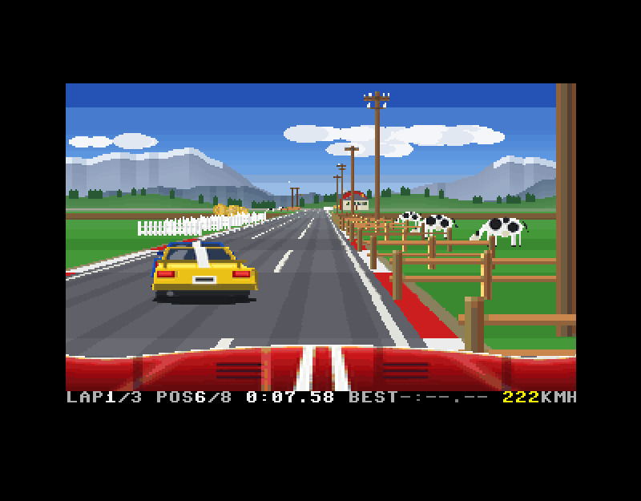

# race — VELOCITY 65

A road racer for the MEGA65, built with the [M65Compiler](../m65compiler)
tool suite (cc45 / ca45 / ln45 / pack45 / disk45). Eight cars, three laps of a
circuit of hills and curves, seen from the driver's seat (the bonnet in
front of you, a rear-view mirror above) or from a chase camera behind the
car. Five red lights start the race; tunnels, fog, rain and night
(headlights) along the route; slipstreams, nitro, lap records and a table
of results at the finish.

The circuit runs through towns (shops, terraces, flats, a church, a filling
station, pavements and street lamps), farm country (farmhouses, red barns
and silos, sheds, a wind pump, tractors, gravel driveways with mailboxes,
post-and-rail and picket fences, dry-stone walls, hedges, hay bales, cows
and sheep, telegraph poles, ploughed fields), meadows with cottages and
bungalows, birch, poplar and apple trees, pine forests, rocky hills of
boulders and dead trees, and a coast of palms. There is a **jump** over a
river - the road ramps up and drops away; too slow and you land in the
water - and a **fork**: the road splits round an island, the right
carriageway has a ramp to hit square at speed to fly a river at full
speed, the left a narrow railed bridge over it.



## Build and run

```sh
make            # build/race.prg and build/race.d81 (the art files are on the disk)
make run        # build and run it in xemu-xmega65, the disk on drive 8
make demo       # the self-driving build, in xemu
make screenshot # run the self-driving build headless -> build/screenshot.png
make profile    # self-driving build with timings on the HUD
make clean
```

Variables: `M65=<path>` (the compiler tree, default `../m65compiler`),
`XEMU=<emulator>`, `SHOT_DELAY=<seconds>`.

On a real MEGA65: copy `build/race.d81` to the SD card, mount it and
`RUN "RACE"`. The program loads its code overlays (`RACE.OV1`), its art
(`VELCHIP`, `VELATTIC`, `VELATT2`-`5`), the circuits (`VELC0`-`VELC7`), the
route map (`VELMAP`) and the music (`VELMUSIC`) from the same drive, and
saves `VELSAVE` there.

## Controls

| Key | Joystick (either port) | Action |
|---|---|---|
| cursor up, W, SPACE | fire or up | accelerate |
| cursor down, S | down | brake |
| N | fire with the stick pulled back | nitro (when the car has it) |
| cursor left / right, A / D | left / right | steer |
| C | | cockpit / chase camera (in the garage: the colour) |
| G | | the garage (from the title or the route map) |
| D | | on the route map: the difficulty (easy / normal / hard) |
| P | | pause |
| M | | music and sounds / sounds only / silence |
| V | | wait for the beam to leave the picture before flipping (no tearing): on / off |
| RUN/STOP | | quit to BASIC (in the garage: back to the map; on the map: the title) |

Fire (or SPACE, RETURN) on the title opens the route map; fire there
races on the circuit chosen, and after the finish (and its results) goes
back to the map. The HUD row shows the lap, your place (p), the lap time,
the race's best lap (b), the nitro left (n: a star per charge) and the
speed (cyan in a slipstream, red with nitro).

## The start, the race and the finish

- **The lights.** Five red lights come on a second apart, then, after a
  moment that is never the same, go out: go. Gas while all five are lit
  is a jump start, and the car bogs down for nearly two seconds; gas
  within a quarter of a second of them going out is a great start, with a
  boost. The other cars each have their own reaction.
- **The slipstream.** Close behind a car in the same lane, at speed, the
  top speed is 15 km/h higher: pull out and pass.
- **Nitro**, bought in the garage (1-3 charges a race): three seconds of
  twice the pull and 31 km/h more, flames from the exhausts.
- **The mirror** (the driver's view) shows the cars close behind.
- **The finish.** Over the line the results come up over the picture:
  each driver, car and time (an estimate, ~, for those still racing,
  until they are over the line), what you won, and the circuit's records.
- **The other drivers** each have their own way: some take the curves
  closer to the limit than others, and some now and then get a hard curve
  wrong - run wide and lift for a second - more often than others.
- **Difficulty** (D on the route map, kept on the disk): easy makes the
  others slower (by about 6 km/h), more careful in the curves, more often
  wrong and slower to close a gap you open; hard the other way round.
- **Records.** Each circuit's best race and best lap are kept on the disk
  (`VELSAVE`) and shown on the route map; a new lap record is announced in
  the HUD row as you set it.

## The circuits and the route map

Eight circuits lie along a route across the country, in pairs: Mega
Circuit, then Farmlands or Harbour Bay, Pine Ridge or Sunset Coast, Canyon
Run or Night City, and the Grand Tour. The route map shows them with the
roads between them: green (a tick) the circuits won, yellow the open ones,
grey the locked; left / right move between the open ones, up / down to
the other of a pair, and the rows under the map give the one chosen (its
time of day or weather, length, jumps, forks, what a win pays, its record
and best lap).

Finishing in the top 3 wins a circuit and opens both of the next pair, so
either can be raced next; a circuit won stays open to be raced again. Win
the Grand Tour to be champion.

| Circuit | Pair | Look | Length | Jumps | Forks | Tunnels |
|---|---|---|---|---|---|---|
| Mega Circuit | 1 | day, mountains | 3.3 km | 1 | 1 | 1 |
| Farmlands | 2 | day, mountains | 2.6 km | 2 | 0 | 0 |
| Harbour Bay | 2 | day, sea coast | 2.6 km | 0 | 1 | 0 |
| Pine Ridge | 3 | fog, mountains | 2.8 km | 1 | 0 | 1 |
| Sunset Coast | 3 | dusk, sea coast | 2.9 km | 1 | 1 | 0 |
| Canyon Run | 4 | dusk, mountains | 3.2 km | 2 | 1 | 1 |
| Night City | 4 | night, mountains | 3.3 km | 1 | 1 | 1 |
| Grand Tour | 5 | rain, sea coast | 4.9 km | 2 | 2 | 1 |

Each is built by `gen_assets.py` (`CIRCUITS`: sections of curves, hills
and themes, drawn out to `CIRC_LEN`) into a file of its own, loaded into
attic RAM at the start: choosing one is instant. Its header gives its
length, jumps and forks, look (a palette each: day, dusk, overcast,
night, fog, rain), weather and panorama (the mountains, or the sea with
islands and dunes).

- **Night**: the headlights light the road in front (the near road's own
  colours, lit in the night palette: no extra drawing); the tail lights
  and the windows glow.
- **Fog**: the road and the scenery are drawn less far (48 segments, the
  scenery 40), the far road and the sky lost in the fog's grey.
- **Rain**: streaks of rain blown by the curves and the steering (not in
  the tunnels), a dark wet palette with a sheen on the near road, the
  cars' tail lights reflected in it below them and spray thrown up behind
  them, and a quarter less grip: the hard curves must be taken slower (the
  other cars know it).
- **Tunnels**: a rock face with a grassy top round the mouth; inside, a
  ceiling lit by lamps, walkways, side walls (tiles below, a dark skirting
  at the foot, concrete above, a lamp on each every few metres) and the
  light at the end; the engine echoes. The walls can't be driven through:
  the car scrapes along them, slower.

## Credits and the garage

A race pays by place (1500 credits for a win, 1000, 700, 500, 350, 250,
150, 100 on the first circuit, half as much again for each pair along the
route: 3 times as much on the Grand Tour) plus 150 for every jump landed
and 250 for flying the fork's ramp; the countdown shows it over the top of
the picture. The opponents are quicker further along the route too.

With G at the title or on the map, the garage: a
showroom with the car in it as chosen, its top speed and grip, and a menu.
Up / down choose a row, left / right change it, fire acts on it, and the
bottom line says what fire will do:

| Row | Left / right | Fire |
|---|---|---|
| CAR, TYRES, WING, NITRO | the model, the tyres, the wing, the nitro | buy it (the price is shown, green when affordable, red when not), or (owned) on to RACE |
| COLOUR | the model's other colour (also C) | the same |
| RACE | | race in the car as shown (all of it owned) on the circuit chosen |
| EXIT | | back to the route map without buying anything (also RUN/STOP) |

Leaving keeps what is shown if all of it is owned, else the car as it
was. Credits, what is owned and what is chosen are saved on the disk
(`VELSAVE`) when they change.

| Car | Top speed | Pull | Grip | Price |
|---|---|---|---|---|
| GT | 300 km/h | 1.00 | 1.00 | owned |
| Hatch | 287 km/h | 1.23 | 1.11 | 2500 |
| Roadster | 294 km/h | 1.13 | 1.25 | 4500 |
| Wedge | 318 km/h | 1.17 | 1.05 | 8000 |

| Tyres | Grip | Off the road | Price |
|---|---|---|---|
| Standard | 1.00 | 110 km/h | owned |
| Fat | 1.20 | 145 km/h | 2000 |

| Wing | Grip | Top speed | Price |
|---|---|---|---|
| None | 1.00 | - | owned |
| Lip | 1.05 | -1 km/h | 1000 |
| High | 1.11 | -4 km/h | 2500 |
| Big | 1.17 | -6 km/h | 4000 |

| Nitro | Charges a race | Price |
|---|---|---|
| None | - | owned |
| 1 shot | 1 | 1500 |
| 2 shots | 2 | 3500 |
| 3 shots | 3 | 6000 |

Grip (the car's, the tyres' and the wing's multiplied) divides the curves'
pull: on a grippier car the hard curves can be taken faster.

The player's wing is a layer of its own, drawn over the body at the
model's body line (`wing_row`), so any car takes any wing; the opponents'
cars have their wings drawn into their bodies (`AI_WING` in
`gen_assets.py`), which costs them nothing to draw.

## Music

Six original tunes, written out by hand in `tools/gen_music.py` (as
tune45 text; `make music` plays them on the PC), each in the manner of a
style of driving music, 90 s to 2 minutes a loop:

| Tune | Style | Key, tempo | Plays |
|---|---|---|---|
| Skyline | dreamy indie dance: sequenced arpeggios, an airy lead | D major, 118 bpm | the title; Farmlands |
| Machine | cold new wave: a doubled synth riff, a mechanical beat | C minor, 128 bpm | Pine Ridge, Night City |
| Afterglow | a wistful ballad: pad, electric-piano arpeggio, soft lead | Eb major, 90 bpm | the garage, the route map |
| Autoroute | motorik: a steady sequencer, bleeps, a vocoder pad, a horn | F major, 130 bpm | the Grand Tour |
| Vicetown | 80s TV-cop: gated snares, toms, brass stabs, a sawtooth lead | A minor, 140 bpm | Harbour Bay, Sunset Coast |
| Overdrive | synthwave: a 16th-note octave bass, a soaring lead with glides | F# minor, 150 bpm | Mega Circuit, Canyon Run |

Each has an intro and then loops through verses, choruses and a
breakdown or bridge. Six voices on SIDs 2 and 3: the lead; a counter-line
(the lead's echo in the verses, a harmony a third below in the choruses, a
pad in the breakdowns); chords, pads or a sequencer through SID 2's
filter, its cutoff swept across whole sections; the bass through SID 3's;
the drums (kick, snares, claps, toms); the hi-hats, shaker and crash. The
melodies are written bar by bar (each checked to make 16 ticks); the bass
lines, arpeggios and drums are built from each bar's chord and a pattern.
The engine and the effects are on SIDs 1 and 4.

## Driving

- The gearbox is automatic; pull is strongest in the low gears.
- Curves push the car outwards, in proportion to the square of the speed.
  The hardest curves can't be taken flat out: lift, or brake, before them.
  The tyres squeal when you are at the limit.
- Off the tarmac the car can't go faster than about 110 km/h and shakes.
- Trees, posts, signs, rocks and the gantry's legs stop you dead; bushes only
  slow you down. Running into another car's back slows you to its speed.
- The other cars brake for the sharp curves; that is where to pass them,
  or out of a slipstream on the straights. The front of the grid is
  quicker than the back.
- The other cars stay within reach of you, whatever happens: ahead of you
  by more than a dozen segments they ease off, the further ahead the more;
  90 segments ahead they go no faster than you, and 150 ahead, out of
  sight, at 3/4 of your average speed (over the last few seconds: if you
  have stopped it falls, and so do they). Behind you by more than a
  dozen segments they push harder the further back they are: faster on the
  straights (up to 28 km/h more), closer to the limit in the curves, and
  quicker off the mark (`racex.c`: `RB_*`).
- Jumps: the warning signs come first. Take the ramp fast (over about
  180 km/h) and straight; too slow and you land in the river (or hit the
  far bank) and are put back past it, slowly. In the air there is almost
  no steering.
- Forks: keep left or right of the island (its nose has a sign: don't
  hit it). On the right carriageway the ramp must be hit square, within
  about a car's width of its middle: off-centre the car clips its edge and
  spins; miss it and you drive into the river. The bridge on the left is
  safe but one lane wide, between railings.

## How it works

**Display** (`src/video.c`). The VIC-IV in full-colour character mode as a
320 x 192 bitmap with a byte per pixel, plus a text row (the HUD). The
cells are numbered down the columns, so a pixel column is a run of bytes 8
apart. Two buffers (banks 4 and 5), flipped in the vertical blank.

**Everything is drawn by DMA** (`src/render.s45`). The MEGA65's DMA
controller can step its source by fractions of a byte (scaling), skip a
transparent colour, and walk an FCM screen *across* (its line-drawing
address calculator, with "X column bytes" = the cell column size - 8). So:

- each **road row** is one copy from a *road profile*: a strip across the
  road (grass, rumble strip, edge line, lanes, tyre marks), with the source
  step set so the strip comes out as wide as the road is at that row.
  The profile has 8 mip levels (each half as wide, box-filtered, and a
  little hazier), so the far road doesn't shimmer. There are 20 variants:
  light and dark (alternating every three segments), two checkered ones
  for the start line, ploughed fields (furrows along the road) light and
  dark, a gravel driveway off to the left or the right, the jumps' and
  the forks', a town's street and a tunnel's (walkways and walls). Where the road
  doesn't reach the screen's edges a fill puts grass (or the field, the
  gravel: each side its own) under it first. Ground features like these
  scroll with the road for nothing.
- each **sky row** is a fill (the gradient) or a copy from the two
  panoramas, the near one transparent, each scrolling at its own rate as
  the road turns.
- each **sprite** (trees, signs, lamps, billboards, the gantry, the cars,
  the bonnet, the banners) is drawn one row or one column at a time,
  scaled, transparent: whichever takes fewer jobs. The textures are stored
  both ways round in attic RAM (the column-by-column copy right after the
  row-by-row one, so one address per sprite).
- in a **tunnel** each segment also has a ceiling, TUN_H above the road,
  projected like the road's edges: its rows, from the top of the screen
  down, are a fill of the wall's colour and a fill of the ceiling's
  between the walls; the ground and the sky leave those rows alone. Then
  each mouth in view: seen from outside, rows of rock (grass on top, a
  lintel over the hole) and the rock either side of the hole down to the
  road; from inside, the walls either side of the light at the end.
  Scenery beyond a mouth isn't drawn.
- each **streak of rain** is one transparent column copy; in the rain each
  car also has a reflection (a sprite hung below it on the road: a
  negative height) and its spray (a sparse sprite, the car showing
  through) drawn with it.

**The road** is a list of segments (256 units long), each with a curve, a
height, a variant and the scenery on either side (a sprite and its
distance from the middle). The road is 1440 units wide: three lanes.
Every frame the renderer projects the edges of the 152 segments ahead
(beyond the 24th every other one, beyond the 72nd every fourth: they
cover a row at most; the ones between are interpolated), fills the rows
between each pair of edges that nearer ground hasn't covered, and keeps every edge's position, scale
and clip row for the sprites, which are drawn far to near and hidden
behind hills.

**The art** (`tools/gen_assets.py`) is all drawn in Python with PIL at 4x
size and scaled down, then reduced to the palette: 48 colours for the sky
and panoramas, 64 for the road (36 for the near road, mip levels 0-2, 28
for the far: so a look can light or fog them apart), 128 for the sprites. It is packed with
pack45 into two files on the disk (the sprites' file must stay under
64 KB: the Makefile checks), loaded at the start into bank 4 and
unpacked by DMA: the panoramas and road profiles to bank 1, the sprites
to attic RAM.

**The cars** are drawn from behind in two layers: a body per *livery* (a
model in a colour: a low GT coupe with a light bar and wing, a hot hatch
with LED corners and a roof spoiler, an open roadster, a wedge with a big
wing and diffuser; two colours each) in three views (turned left,
straight, turned right: the cabin shifts, a flank shows), and an *axle*
(the shadow and the tyres) per tyre type (standard, fat) in three views
and two tread frames. The axle is drawn first and the body over it, the
same size, so any body takes any tyres: the player's car is
`player_livery` and `player_tyre`, ready to be upgraded as a reward. The
tread steps with the distance the car travels (every frame at speed). A
car's view is its steering, and where it is relative to the camera.

**Jumps and forks.** Near them (the track lists them, `feat_*`) every car
has a height and a vertical speed: on the road it follows the road; when
the road falls away faster than gravity would pull the car down (the end
of a ramp), it flies, and lands on the road, in the water (back on the
road past it), or against the far bank's face. The fork's ramp is a
sprite on the flat road: driving over its segment launches the car
(square on) or spins it (on its edge). The renderer draws the jump from
the heights alone (the gap is a water variant far below, its last segment
the bank's face); the divided road is 1.8 times as wide (a width per
segment) with its own variants (two carriageways and an island; a bridge
deck and water). Cars in the air are drawn their height above the road.
The chase camera's height follows the car's with a lag, so the car leaps
up the screen.

**The game** (`src/game.c`, `src/track.c`). The world moves in steps of
one video frame (50 Hz), however long a picture takes to draw. The track
is built by `tools/gen_assets.py` from a list of sections (eased curves,
cosine hills, a scenery theme each) and loaded into attic RAM. The farm theme lays out a farm every
64 segments on alternate sides: the driveway and its mailbox, the house,
the barn and silo, a picket fence, then fields of hay bales; across the
road a fence or a wall, telegraph poles and cows. Every frame the 154
segments in view are copied to bank 0 by DMA. The other cars keep to lanes, change lanes
round slower cars, brake for curves, and are held within reach of the
player.

**Sound** (`src/sound.c`). The engine is a pulse wave following the rpm of
an automatic five-speed gearbox; noise for the tyres, the gravel and
crashes; beeps for the countdown; in a tunnel the beeps' voice plays the
engine again a few frames late, a little flat and softer, for its echo.
The same on the left and right SID.

## Performance

In xemu: 50 fps (the full frame rate) on most of the circuit, in fog and
in the tunnels; 36-45 on the busiest stretches (a town's tall buildings
with traffic, the grid at the start, the town in the rain). Per frame about
8-12 ms for the road and the sky (the tunnels' ceilings take the sky's
place), 4-10 ms for the sprites (the mirror, the rain and the lights
included), 2-3 ms for the game.

Against flicker:
- A new picture is shown only while the beam is outside it: below the
  image, or, in the cockpit view, below the top of the bonnet (rows 170 on
  are the same in both buffers: drawn once, the bonnet), or above it. So
  the picture never tears; a late frame waits for that, at most a fraction
  of a frame in the cockpit view.
- A road segment that covers a single row on the screen (far away) is
  always drawn as a light one: otherwise the row would take whichever
  stripe lands on it, flashing light and dark as the road moves.
- The road is mip-mapped (see above), so the far lanes and rumble strips
  don't shimmer.

## Memory

| Where | What |
|---|---|
| `$0800`-`$0FFF` | (the BASIC screen, unused while the game runs) the renderer's base page, the window's scenery, the HUD's row buffers, the rain (`$0C20`), and tables that never change, copied in from attic RAM at the start (`$0CA0`: the sprites' sizes, the sky's colours) |
| `$1600`-`$1F0F` | the edges' projection, the track window, the cars to draw; the save record (`$1E40`) and a file name for the KERNAL; `kcall`'s state (`$1F00`: the program's data reaches `$C000`, ROM while a KERNAL routine's registers are loaded) |
| `$2001`-`$A5FF` | program, tables, its data |
| `$A600`-`$CDFF` | the code overlays' region: the race (`racex.c`: every frame of a race and the title's), what runs once at a race's start and end (`results.c`), the garage (`garage.c`), the route map (`map.c`), or the setting up: loading, saving, the display, the circuit chosen, the race's grid (`disk.c`, `vsetup.c`), copied in from attic RAM when called |
| `$CE00`-`$CFFF` | the stack (512 bytes: a race and the garage use under 256); the RAM under the ROM at `$C000` is the program's while it runs (ln45 `--ram-top`): the ROM is mapped out before anything runs (`kernal.s45`'s `init`), and back in only around each KERNAL call (`kcall`) |
| bank 1 `$12000`- | road profiles (18 variants x 8 mips); `$1C000`, `$1C800`: the two screens (BASIC's variables are gone after quitting) |
| `$40000`-`$4EFFF` | buffer A (loading: the packed art) |
| `$50000`-`$5EFFF` | buffer B |
| `$8000000`- | panoramas (the mountains, the coast), sprites both ways round, the palettes (a look each): about 940 KB, in five files of up to 224 KB |
| `$8100000`- | the circuits, `$A000` apart: each 9 arrays of 4096 bytes and a header |
| `$8160000`- | the route map's picture (as a buffer: column-major cells) |
| `$8200000`- | the music (`VELMUSIC`) |
| `$8300000`- | the code overlays (`RACE.OV1`: the startup code loads it into bank 5 and copies it here) |

## Layout

```
Makefile
src/game.c        game loop, states, physics, camera, the player's car
src/game.h        what game.c shares with its overlays
src/racex.c       the other cars, collisions, the start lights, slipstream, nitro,
                  rain, mirror, banners, HUD (code overlay "racex")
src/results.c     what a race pays, the finish, the results, the records (code overlay "results")
src/garage.c      the garage (code overlay "garage")
src/map.c         the route map (code overlay "routes")
src/disk.c        loading the art and the save, saving, the circuit chosen, the grid (code overlay "disk")
src/vsetup.c      the display set up and back, the looks' palettes (code overlay "disk")
src/kernal.s45    KERNAL calls with the ROM at $C000 mapped in (also the overlay loader's)
src/track.c       the circuit raced on: its header, the window around the camera
src/render.s45    projection, road, sky and sprites by DMA
src/video.c       VIC-IV FCM setup, double buffering, HUD text
src/sound.c       SID engine and effects
tools/gen_assets.py  art, palette and tables -> build/
tools/screenshot.py  headless xemu screenshot (DISK=<d81> mounts a disk)
```

## Notes

- Most of the code is in code overlays (ln45, copied: `#pragma cc45
  overlay(...)` at the top of `racex.c`, `results.c`, `garage.c`, `map.c`,
  `disk.c` and `vsetup.c`), so bank 0 holds only the largest of them. They
  are kept in attic RAM and copied into the region when called (about 0.1
  ms per KB). `racex` is the only one the title, the countdown, the race
  and its finish call every frame, so it stays in the region while they
  run; `results` is called once at the countdown, at the finish and every
  second while the results are up (each time copying `racex` back after
  it); the others only outside races. More can go in any of them up to the
  region's size (`racex`'s, about 10 KB) at the cost of a 6-byte stub per
  function called from outside; code added to `racex` itself grows the
  region. (The map's overlay is "routes": `map` is the 45GS02's MAP to the
  assembler.) The startup code loads `RACE.OV1` through `__rom_call`:
  `kernal.s45` has its own (ln45 warns that it overrides the library's),
  which maps in the ROM at `$C000` as `kcall` does, since the program's
  stack is there.

- cc45's plain `char`/`int`/`long` are unsigned; the sources write `signed`
  where a value can be negative.
- Build switches (`DEFS=...`): `-DDEMO` (drives by itself, starts races,
  goes on to the map after the finish), `-DCIRC=<n>` (start on circuit n),
  `-DLAPS=<n>` (laps a race), `-DMAP` (to the route map with two circuits
  won, and a script of presses),
  `-DPROFILE` (timings on the HUD: fps, road, sprites, game logic in
  0.1 ms), `-DPROFILE_NODMA` (no DMA jobs: CPU time only),
  `-DPROFILE_NOROWS` (projection only), `-DFREEZE` (nothing moves; the
  cockpit view of the grid), `-DSTART_AT=<segment>` (the player starts
  there: with `-DFREEZE`, a look at any part of the circuit),
  `-DDEBUG_PLACE` (a log of the cars placed, `dbg_log`).
- The `#if` guards in `render.s45` avoid `&` and `%`: cp45 evaluates them
  wrongly (M65Compiler issue #375).
- `-DCHASE`: the chase camera in races (for looking at jumps);
  `-DGARAGE`: straight to the garage with 20000 credits and a script of
  presses (buy the hatch, fat tyres, the high wing and a nitro shot, the
  other colour, race); with `-DGARAGE_EXIT` too, down to EXIT and fire.
  (The game saves `VELSAVE` to the disk it runs from: a test build's disk
  keeps what an earlier run bought until it is built again.)
- `-DDEMO` also gives the car three nitro charges and fires one every
  ten seconds, and keeps no records.
- The save record grew (the nitro, the records): a save from before has
  no `rec_magic`, and keeps its credits and cars with the new fields
  cleared.
- A struct at a cast constant address (`(*(struct s *)0x1E40).m = v`) is
  written wrongly by cc45 (the temporary's address is written instead):
  the save record and the row buffers are `__section` variables instead.
- Where a `signed long` meets an `unsigned char` / `unsigned int` in a
  multiplication followed by a division or a shift, the sources cast both
  to `signed long`: cc45 does the operation unsigned (issue #377).
